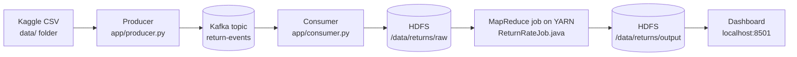

# Product Return-Rate Pattern Analysis

**Kafka · HDFS · MapReduce · Dashboard**: a small big-data pipeline that finds out which product categories are being returned too often.

This README explains, step by step and in plain language: what the project is about, what it does, how it works inside, and exactly how to run it on **Windows** and on **macOS**.

---

## Contents

1. [What this project is about](#1-what-this-project-is-about)
2. [What this project does](#2-what-this-project-does)
3. [Quick start (for people who already have Docker)](#3-quick-start-for-people-who-already-have-docker)
4. [How it works inside](#4-how-it-works-inside)
5. [Project structure](#5-project-structure)
6. [What you need before you start](#6-what-you-need-before-you-start)
7. [One-time setup on Windows](#7-one-time-setup-on-windows)
8. [One-time setup on macOS](#8-one-time-setup-on-macos)
9. [Running the project (same commands on Windows and macOS)](#9-running-the-project-same-commands-on-windows-and-macos)
10. [The three web pages explained](#10-the-three-web-pages-explained)
11. [Useful options](#11-useful-options)
12. [Stopping, restarting and resetting](#12-stopping-restarting-and-resetting)
13. [Configuration](#13-configuration)
14. [Troubleshooting](#14-troubleshooting)
15. [Design decisions and limitations](#15-design-decisions-and-limitations)
16. [What was tested](#16-what-was-tested)

---

## 1. What this project is about

### The business problem

An online shop sells thousands of products every day, and customers send some of them back. Every return costs money: postage, checking the item, repackaging it, the refund, and the lost sale.

If one **category** of products (for example Electronics or Clothing) is returned far more often than the others, something is wrong. It could be a faulty product, a wrong size chart, or a misleading photo.

The finance team cannot see this today, because return data is only reviewed **once every quarter (three months)**. A problem can run for weeks before anyone notices.

> *"Finance teams cannot identify which products or categories are driving rising return costs because return data is analyzed only in quarterly reviews."*

### The idea

Instead of waiting three months, look at the data **every week**. For every week and every product category, work out the **return rate**:

```
return rate  =  number of returns  ÷  number of orders       (same category, same week)
```

If a category's return rate is **above 10%**, flag it. A dashboard shows all categories so that finance can spot the problem at a glance.

### Why these technologies

The project is built with exactly four technologies, which together form a classic big-data pipeline:

| Technology | In plain words | Why it is used here |
|---|---|---|
| **Apache Kafka** | A system that receives a continuous flow of small messages and holds them in order until a program is ready to read them (like a conveyor belt). | The order and return events arrive continuously. Kafka lets the data flow in without the receiving program having to keep up at that exact moment. |
| **Hadoop HDFS** | A file system that stores very large amounts of data by spreading files over many machines. | Kafka only keeps messages for a limited time. HDFS stores all the events permanently, ready for analysis. |
| **Hadoop MapReduce** | A way to process huge data by splitting it into small pieces, processing the pieces in parallel, then combining the partial answers (like counting votes at many polling booths and then adding the totals). | Counting orders and returns per week per category can be split into independent pieces, so it keeps working as the data grows. |
| **Dashboard** | A web page with charts and tables. | Numbers in a file help nobody. A chart with a red 10% line shows the problem in seconds. |

Everything runs inside **Docker**, so you do not need to install Java, Hadoop, Kafka or Python yourself. Docker runs each tool in its own sealed box (a *container*), and a single command starts them all.

---

## 2. What this project does

The project builds a pipeline with four stages: **Stream → Store → Compute → Show**.



| Stage | What happens | Program |
|---|---|---|
| **1. Stream** | The **producer** reads the e-commerce CSV one row at a time and sends each order, and each return request, to Kafka as a small message (an *event*). | `app/producer.py` |
| **2. Store** | The **consumer** reads the events from Kafka and saves them as files in HDFS, in batches of up to 20,000 events. | `app/consumer.py` |
| **3. Compute** | A **MapReduce job** counts orders and returns for every (week, category) pair, calculates the return rate, and marks any category above 10% as `FLAGGED`. | `mapreduce/ReturnRateJob.java` |
| **4. Show** | The **dashboard** reads the result from HDFS and shows the weekly return rate of every category, with flagged categories in red. | `app/dashboard.py` |

### What you get at the end

A dashboard at <http://localhost:8501> that shows, for any week you pick:

- how many categories there are, how many are flagged, and the overall return rate;
- a bar chart with one bar per category and a dashed red line at 10%. Bars above the line are red;
- a table of the same numbers;
- a trend chart of every category's return rate over time;
- a list of every flagged (week, category) combination in the data.

The raw result is also a plain text file in HDFS (`/data/returns/output/part-r-00000`):

```
week      category     orders  returns  return_rate  status
2024-W01  Clothing     1221    195      0.1597       FLAGGED
2024-W01  Electronics  1235    79       0.0640       OK
```

---

## 3. Quick start (for people who already have Docker)

Needs Docker Desktop running and the Kaggle CSV downloaded. Details and explanations are in sections 6 to 9.

```bash
git clone https://github.com/Dheeraj64209/BDA-project.git
cd BDA-project

# put your Kaggle CSV into the data/ folder (exactly one .csv file there)

docker compose up -d --build                                # start Kafka, HDFS, YARN, consumer, dashboard
docker compose run --rm producer                            # stream the CSV into Kafka
# wait about 15 seconds so the consumer can finish writing to HDFS
docker compose exec resourcemanager bash /opt/jobs/run_job.sh   # run the MapReduce job
```

Then open <http://localhost:8501>.

---

## 4. How it works inside

### 4.1 What one CSV row becomes

The producer needs three pieces of information from each row: the **product category**, the **date** of the order, and whether it was **returned**. For a returned Electronics order from 2 February 2024 it sends **two** events (an ORDER and a RETURN_REQUEST):

```json
{"event_type": "ORDER",          "category": "Electronics", "event_date": "2024-02-02", "row": 2}
{"event_type": "RETURN_REQUEST", "category": "Electronics", "event_date": "2024-02-02", "row": 2}
```

A row that was *not* returned produces only the ORDER event. A return rate is a fraction (returns ÷ orders), so the pipeline needs both numbers. That is why there are two kinds of event.

### 4.2 Stage 1: the producer (CSV → Kafka)

- Finds the category, date and return columns by looking at the CSV header (see [column detection](#column-detection)) and prints what it chose, so you can check it.
- Creates the Kafka topic `return-events` (3 partitions) if it does not exist.
- Sends an ORDER event for every row, plus a RETURN_REQUEST event for returned rows.
- Uses the **category as the message key**. Kafka sends all messages with the same key to the same partition, so one category's events stay together and in order.
- Skips rows with a missing category or date, and tells you how many were skipped.

### 4.3 Stage 2: Kafka

Kafka runs as a single broker in **KRaft mode** (Kafka manages itself, so no separate ZooKeeper program is needed). The topic `return-events` has **3 partitions**. A partition is like one lane of a conveyor belt: order is guaranteed inside a lane. Kafka does not delete a message when it is read; each reader keeps its own bookmark (the *offset*).

### 4.4 Stage 3: the consumer (Kafka → HDFS)

- Reads events from Kafka and collects them into a batch. A batch is written when it holds **20,000 events**, or **10 seconds** after its first event, whichever comes first. HDFS prefers a few large files over many tiny ones.
- Saves each batch as a **JSON Lines** file (one event per line) in `/data/returns/raw`.
- Writes to a temporary file name starting with `_`, then renames it. MapReduce ignores names starting with `_`, so a job can never read a half-written file.
- Tells Kafka "I have processed up to here" (commits the offset) **only after** the file is safely in HDFS. After a crash it restarts from its last confirmed position, so no event is lost. This is *at-least-once* delivery: in the rare case of a crash exactly between saving and confirming, a batch could be saved twice.

### 4.5 Stage 4: HDFS

HDFS stores files across machines by cutting them into **blocks**, and keeps copies for safety (*replication*). Two kinds of server cooperate: the **NameNode** keeps the catalogue (which file is made of which blocks) and the **DataNode** holds the actual blocks. This project runs one of each, so replication is set to 1. A real cluster would normally use 3.

| HDFS folder | Contains | Written by |
|---|---|---|
| `/data/returns/raw` | All events, as `.jsonl` files | the consumer |
| `/data/returns/output` | The result file `part-r-00000`, and an empty `_SUCCESS` file that means "the job finished correctly" | the MapReduce job |

### 4.6 Stage 5: MapReduce

MapReduce works in phases. Think of counting votes after an election: every polling booth sorts its ballots into piles by candidate (**map**), totals its own piles (**combine**), the piles for the same candidate are carried to the same counting table (**shuffle**), and each table adds its piles and announces the total (**reduce**). Here a "ballot" is an event, and a "candidate" is a (week, category) pair.

| Phase | What it does in this job | Example output |
|---|---|---|
| **Map** | Reads each JSON line, works out the ISO week from the date, and emits a key and a value: ORDER gives `1,0` and RETURN_REQUEST gives `0,1`. Lines that cannot be read are skipped and counted. | `2024-W05\|Electronics → 1,0` |
| **Combine** | On each map task, adds up the values with the same key before sending them anywhere, so far less data travels. | `2024-W05\|Electronics → 2,1` |
| **Shuffle and sort** | Automatic. Brings every value with the same key to the same reducer. | |
| **Reduce** | Adds all orders and all returns, calculates `returns ÷ orders`, and writes `FLAGGED` if the rate is **above** 0.10, otherwise `OK`. | `2024-W05  Electronics  2  1  0.5000  FLAGGED` |

**A tiny worked example** with five rows from early February 2024:

| Row | Date | Category | Returned? | ISO week | Events created |
|---|---|---|---|---|---|
| A | 1 Feb | Electronics | No | 2024-W05 | ORDER |
| B | 2 Feb | Electronics | Yes | 2024-W05 | ORDER + RETURN_REQUEST |
| C | 1 Feb | Clothing | Yes | 2024-W05 | ORDER + RETURN_REQUEST |
| D | 3 Feb | Clothing | No | 2024-W05 | ORDER |
| E | 5 Feb | Electronics | No | 2024-W06 | ORDER |

| Key (week \| category) | Orders | Returns | Return rate | Status |
|---|---|---|---|---|
| 2024-W05 \| Electronics | 2 | 1 | 1 ÷ 2 = 50% | FLAGGED |
| 2024-W05 \| Clothing | 2 | 1 | 1 ÷ 2 = 50% | FLAGGED |
| 2024-W06 \| Electronics | 1 | 0 | 0 ÷ 1 = 0% | OK |

(With only five rows the percentages are huge. With real data there are thousands of orders per category per week.)

Other details of the job:

- It runs on **YARN**, Hadoop's job manager. The *ResourceManager* accepts the job and the *NodeManager* runs the map and reduce tasks.
- It uses **one reducer**, because the result is small and the dashboard then reads a single file.
- It uses `CombineTextInputFormat`, which packs many small input files into big chunks, so Hadoop does not start one task per tiny file.
- A return is counted in the week of its **order date**, because the dataset has no separate "return date".
- Weeks are **ISO weeks** (Monday to Sunday, numbered from 1), written like `2024-W05`.

### 4.7 Stage 6: the dashboard

A [Streamlit](https://streamlit.io) web app that reads the result file from HDFS (over WebHDFS) and draws it with Altair charts. Results are cached for at most 30 seconds; the **Refresh** button reloads them immediately.

### Column detection

The producer finds the right columns by comparing the CSV header with a list of common names. The comparison ignores upper/lower case, spaces, underscores and punctuation, so `Product Category`, `product_category` and `ProductCategory` are all the same.

| It needs | Header names it recognises |
|---|---|
| Category | Product Category, Category, Category Name, Product Category Name, Product Type |
| Date | Purchase Date, Order Date, Transaction Date, Invoice Date, Order DateTime, Date, Timestamp |
| Returned? | Returns, Returned, Return Status, Is Returned, Return Flag, Return, Return Requested |

A row counts as **returned** when the return column holds `1`, `1.0`, `true`, `yes`, `y`, `returned` or `return` (any capitalisation). Anything else (`0`, `0.0`, `no`, `Not Returned`, or empty) counts as not returned.

Dates are recognised in these formats: ISO (`2024-02-02`, `2024-02-02 10:30:00`), `mm/dd/yyyy`, `dd/mm/yyyy`, `dd-mm-yyyy` (each with or without a time), and `yyyy/mm/dd`. One format is chosen for the whole file by testing the first 1,000 dates. If your file's dates are ambiguous (for example `03/04/2024`), force the format with `--date-format` (see [Useful options](#11-useful-options)).

If your column names are different, you can name them yourself. If you do not, the producer stops and prints the column names it found.

---

## 5. Project structure

```
BDA-project/
├── README.md                  this file
├── docker-compose.yml         describes all the containers and how they connect
├── hadoop.env                 Hadoop settings (HDFS, YARN and MapReduce memory and addresses)
├── Dockerfile                 builds the image for the Python programs
├── requirements.txt           Python libraries (kafka-python, hdfs, streamlit, pandas)
├── .dockerignore              keeps the dataset out of the Docker build
├── .gitignore / .gitattributes
├── data/                      PUT YOUR KAGGLE CSV HERE (the CSV itself is not stored in git)
├── app/
│   ├── common.py              settings shared by the Python programs (addresses, topic name, 10% threshold)
│   ├── producer.py            CSV  -> Kafka
│   ├── consumer.py            Kafka -> HDFS
│   └── dashboard.py           HDFS results -> web dashboard
└── mapreduce/
    ├── ReturnRateJob.java     the MapReduce job (mapper, combiner, reducer)
    ├── run_job.sh             runs the job on YARN and prints a summary
    └── Dockerfile             compiles the job and adds it to the Hadoop image
```

When the project is running, Docker starts these containers:

| Container | What it is | Web page |
|---|---|---|
| `kafka` | Kafka broker | none |
| `namenode` | HDFS NameNode (the catalogue) | <http://localhost:9870> |
| `datanode` | HDFS DataNode (stores the data blocks) | none |
| `resourcemanager` | YARN ResourceManager (job boss; also holds the MapReduce job) | <http://localhost:8088> |
| `nodemanager` | YARN NodeManager (runs the map and reduce tasks) | none |
| `consumer` | Python program: Kafka → HDFS | none |
| `dashboard` | Python (Streamlit): the dashboard | <http://localhost:8501> |
| `producer` | Python program: CSV → Kafka. Started only when you run it. | none |

---

## 6. What you need before you start

**Computer**

| | Minimum | Recommended |
|---|---|---|
| Memory (RAM) given to Docker | 6 GB | 8 GB (so your computer should have 16 GB) |
| Free disk space | 10 GB | 15 GB |
| Internet | needed for the first start only (several GB of downloads) | |

**Software**

- **Docker Desktop**, which includes Docker Compose. Setup is in section 7 (Windows) or section 8 (macOS).
- **Git** to download the project (optional: you can also use *Code → Download ZIP* on the GitHub page).
- Nothing else. Java, Hadoop, Kafka and Python are all inside Docker.

**Dataset**

The Kaggle **E-commerce Transactions** dataset (use the one your course or project brief names, because several Kaggle datasets share that name). It must be a CSV file containing, for each row, a **product category**, an **order or purchase date**, and a **returned** column (see [Column detection](#column-detection)). To download it:

1. Go to <https://www.kaggle.com> and sign in (a free account is enough).
2. Open the dataset page and click **Download**.
3. Unzip the downloaded file. You need the one `.csv` file that holds the transactions.

> **Tip: look at your CSV first.** Open it and check that the header row has columns for category, date and returned, and note their exact names.
> Windows (PowerShell): `Get-Content .\data\your-file.csv -TotalCount 3`
> macOS (Terminal): `head -3 data/your-file.csv`

---

## 7. One-time setup on Windows

These steps are for Windows 11 and for 64-bit Windows 10 (version 22H2 or newer). You do them once per computer.

### Step 1: Check that virtualization is on

Open **Task Manager** (Ctrl + Shift + Esc) → **Performance** tab → **CPU**. Look for **Virtualization: Enabled** at the bottom right.

*Why:* Docker runs Linux containers inside a lightweight virtual machine, which needs this CPU feature. If it says *Disabled*, turn on "Intel VT-x" / "AMD-V" (sometimes called "SVM Mode") in your computer's BIOS settings. The exact steps depend on the manufacturer.

### Step 2: Install WSL 2

Open **PowerShell as Administrator** (Start menu → type *PowerShell* → right-click → *Run as administrator*) and run:

```powershell
wsl --install
```

Restart the computer when it asks.

*Why:* WSL 2 (Windows Subsystem for Linux) is the engine Docker Desktop uses on Windows. If it is already installed, the command just tells you so.

### Step 3: Install Docker Desktop

1. Download **Docker Desktop for Windows** from <https://www.docker.com/products/docker-desktop/>. Choose the AMD64 build for normal PCs, or ARM64 if your PC has a Snapdragon / ARM processor.
2. Run the installer. Keep **"Use WSL 2 instead of Hyper-V"** ticked.
3. Restart if the installer asks.
4. Start **Docker Desktop** from the Start menu and accept the licence agreement. You can skip signing in.
5. Wait until the bottom-left corner of the Docker Desktop window shows **Engine running** (green).

*Why:* Docker Desktop provides the `docker` and `docker compose` commands used in this project.

### Step 4: Check that Docker works

Open **PowerShell** (a normal one) and run:

```powershell
docker --version
docker compose version
docker run --rm hello-world
```

You should see two version numbers, and then a message that starts with **"Hello from Docker!"**.

*Why:* this proves that Docker is installed, running, and able to download and run containers, before you start the project.

### Step 5: Give Docker enough memory

Docker Desktop on Windows uses WSL 2, which by default takes half of your computer's RAM. If you have 16 GB or more, the default is usually fine. If you have 8 GB, or you see containers stopping with exit code 137 (see [Troubleshooting](#14-troubleshooting)), set it yourself:

1. Create (or edit) a file called **`.wslconfig`** in your user folder, `C:\Users\<your-name>\.wslconfig`, with this content:

   ```ini
   [wsl2]
   memory=8GB
   ```

   Use `6GB` if your computer has only 8 GB in total.
2. In PowerShell run `wsl --shutdown`, then start Docker Desktop again.

*Why:* the pipeline runs Kafka, HDFS and YARN at the same time, which needs roughly 6 GB.

### Step 6: Install Git (optional)

Download it from <https://git-scm.com/download/win> and install it with the default options (or run `winget install --id Git.Git -e` in PowerShell). Check with:

```powershell
git --version
```

Without Git, use **Code → Download ZIP** on the GitHub page and extract the ZIP instead.

Setup is done. Continue with [section 9](#9-running-the-project-same-commands-on-windows-and-macos). Use **PowerShell** (or Windows Terminal) for every command.

> **Using Git Bash on Windows?** Put `MSYS_NO_PATHCONV=1` in front of any `docker compose exec` command (for example `MSYS_NO_PATHCONV=1 docker compose exec resourcemanager bash /opt/jobs/run_job.sh`). Otherwise Git Bash rewrites `/opt/jobs/...` into a Windows path and the command fails. PowerShell does not have this problem.

---

## 8. One-time setup on macOS

### Step 1: Find out which chip your Mac has

Click the **Apple menu → About This Mac**. It shows either **Chip: Apple M1 / M2 / M3 / M4 …** (this is *Apple silicon*) or **Processor: Intel …**.

*Why:* you need to download the right Docker Desktop, and Apple silicon needs one extra setting (Step 3).

### Step 2: Install Docker Desktop

1. Download **Docker Desktop for Mac** from <https://www.docker.com/products/docker-desktop/>. Pick **Apple silicon** or **Intel chip** to match Step 1.
2. Open the downloaded `.dmg` file and drag **Docker** into **Applications**.
3. Open **Docker** from Applications. Accept the licence and allow it to install its helper components when it asks for your Mac password. You can skip signing in.
4. Wait until the Docker icon in the menu bar stops animating and Docker Desktop shows **Engine running**.

### Step 3: Apple silicon only: enable Rosetta

The official Hadoop image used by this project (`apache/hadoop`) is built only for Intel/AMD processors. On an Apple-silicon Mac, Docker runs it through emulation. Rosetta makes that emulation fast and reliable.

1. In Docker Desktop open **Settings** (the gear icon) → **General**.
2. Tick **"Use Rosetta for x86_64/amd64 emulation on Apple Silicon"**.
3. Click **Apply & restart**.

If you cannot see this option, update Docker Desktop and macOS to their latest versions. The wording of this setting can differ between Docker Desktop versions.

*Why:* without Rosetta, Docker falls back to a slower emulator under which Java programs such as Hadoop can crash. You will also see a harmless warning that the image platform (`linux/amd64`) does not match your Mac (`linux/arm64`). That is expected. Intel Macs do not need this step.

> **Expect slower runs on Apple silicon.** Kafka, Python and the dashboard run natively, but the four Hadoop containers are emulated, so the first start and the MapReduce job take longer than on an Intel machine.

### Step 4: Give Docker enough memory

In Docker Desktop: **Settings → Resources** → set **Memory** to at least **6 GB** (8 GB if your Mac has 16 GB or more) → **Apply & restart**.

*Why:* the pipeline runs Kafka, HDFS and YARN at the same time, which needs roughly 6 GB.

### Step 5: Check that Docker works

Open **Terminal** (Applications → Utilities → Terminal) and run:

```bash
docker --version
docker compose version
docker run --rm hello-world
```

You should see two version numbers and then **"Hello from Docker!"**.

### Step 6: Make sure Git is available

```bash
git --version
```

If Git is missing, macOS offers to install the Command Line Developer Tools. Accept, and wait for the install to finish. Without Git, use **Code → Download ZIP** on the GitHub page and unzip it.

Setup is done. Continue with [section 9](#9-running-the-project-same-commands-on-windows-and-macos). Use **Terminal** for every command.

---

## 9. Running the project (same commands on Windows and macOS)

Before you begin, make sure **Docker Desktop is running** (see "Engine running" in its window).

Every command below must be run **from the project folder**, the folder that contains `docker-compose.yml`. If you get "no configuration file provided: not found", you are in the wrong folder.

### Step 1: Get the project

```bash
git clone https://github.com/Dheeraj64209/BDA-project.git
cd BDA-project
```

*What this does:* downloads the project into a folder called `BDA-project` and moves into it.
*If you downloaded the ZIP instead:* extract it, then open a terminal in that folder (Windows: open the folder in File Explorer, right-click an empty area and choose **Open in Terminal**; macOS: type `cd ` in Terminal, drag the folder into the window, press Enter).

### Step 2: Put the dataset in the `data/` folder

Copy the Kaggle CSV into the project's `data/` folder.

Windows (PowerShell):

```powershell
Copy-Item "$HOME\Downloads\your-file.csv" .\data\
dir data
```

macOS (Terminal):

```bash
cp ~/Downloads/your-file.csv data/
ls data
```

(Replace `your-file.csv` with the real file name. You can also drag and drop the file into the `data` folder using File Explorer or Finder.)

*What this does:* the producer reads its input from this folder. *Check:* the listing must show **exactly one `.csv` file** (the `.gitkeep` file is a harmless placeholder). If you downloaded a ZIP with several CSVs, copy only the transactions file.

### Step 3: Start everything

```bash
docker compose up -d --build
```

*What this does:* builds the two custom images (the Python programs, and Hadoop with the compiled MapReduce job inside), downloads Kafka and Hadoop, and starts all seven containers in the background (`-d`).

- **The first run takes several minutes**, typically 5 to 15, depending on your internet speed, because several gigabytes are downloaded. Later runs start in about half a minute.
- You will see lots of "Pulling" and "Building" lines, and finally lines such as `Container return-rate-kafka-1  Started`.

*Check that everything is up:*

```bash
docker compose ps
```

You should see **seven services** (`kafka`, `namenode`, `datanode`, `resourcemanager`, `nodemanager`, `consumer`, `dashboard`) with the status **Up**.

*Check that the consumer is ready:*

```bash
docker compose logs consumer --tail 5
```

Wait until you see this line (about 30 to 60 seconds after the start):

```
Consuming 'return-events' -> hdfs:///data/returns/raw
```

A few `Waiting for Kafka (1/60): NoBrokersAvailable` lines before it are **normal**: the consumer is simply waiting for Kafka to finish starting.

### Step 4: Stream the dataset into Kafka

```bash
docker compose run --rm producer
```

*What this does:* starts the producer in a temporary container. It reads the CSV row by row and sends the events to Kafka. It prints which columns it found, then progress, then a summary. For example:

```
Reading Sales.csv: category='Product Category', date='Purchase Date', return='Returns', date format=ISO
  50,000 rows sent
Done in 4.6s: 60,000 ORDER and 5,065 RETURN_REQUEST events sent to topic 'return-events' (0 rows skipped: missing category or date)
```

**Read the first line carefully.** It tells you which columns the producer picked. If one is wrong, or the producer stops with an error, see [Useful options](#11-useful-options) and [Troubleshooting](#14-troubleshooting).

> **Run the producer once per fresh start.** Events are *added* to HDFS, not replaced. Running it twice with the same file doubles every count. To load a different file, or to start again, follow [Stopping, restarting and resetting](#12-stopping-restarting-and-resetting).

### Step 5: Check that the events reached HDFS

Wait about **15 seconds** after the producer finishes, so the consumer can write its last batch. Then run:

```bash
docker compose logs consumer --tail 10
```

You should see one line per file, for example `Wrote 20,184 events to /data/returns/raw/events-20261014-142237-d2d215.jsonl`. When the lines stop appearing, everything has been written.

*Optional exact check.* Count the events stored in HDFS:

```bash
docker compose exec namenode bash -c "hdfs dfs -cat '/data/returns/raw/*.jsonl' | wc -l"
```

The number must equal **ORDER + RETURN_REQUEST** from the producer's summary line (in the example above, 60,000 + 5,065 = 65,065). If it is lower, wait a few more seconds and run it again.

*Look at the files in your browser:* open <http://localhost:9870>, then **Utilities → Browse the file system**, and go to `/data/returns/raw`.

### Step 6: Run the MapReduce job

```bash
docker compose exec resourcemanager bash /opt/jobs/run_job.sh
```

*What this does:* submits the job to YARN. It first deletes the previous result (Hadoop refuses to write into a folder that already exists), then reads every event in `/data/returns/raw`, and writes the result to `/data/returns/output`.

- It takes **about a minute** on a normal laptop (a few minutes on an Apple-silicon Mac).
- You will see Hadoop's progress lines (`map 0% reduce 0%` … `map 100% reduce 100%`).
- *Watch the job live* at <http://localhost:8088>.

It finishes with lines like:

```
Job job_... completed successfully
...
Result: /data/returns/output/part-r-00000  (week, category, orders, returns, return_rate, status)
60 category-weeks computed, 16 flagged above the 10% return-rate threshold
Dashboard: http://localhost:8501
```

If you see `completed successfully`, the job worked.

### Step 7: Open the dashboard

Open <http://localhost:8501> in your browser.

- Choose a week in the **Week** drop-down (newest week first).
- The three numbers at the top show how many categories there are, how many are **flagged** (above 10%), and the overall return rate for that week.
- In the **bar chart**, each bar is one category. **Red bars** are above the dashed red 10% line; blue bars are fine. Hover over a bar for the exact orders, returns and rate.
- **Weekly trend** shows how every category's return rate moves from week to week. This is how a *rising* return cost shows up.
- **All flagged category-weeks** lists every combination in the data that went above 10%.
- If the page was already open before the job finished, click **Refresh**.

If the dashboard says *"No results yet"*, the MapReduce job has not been run, or has not finished (Step 6).

You have now run the whole pipeline: **Stream → Store → Compute → Show**.

---

## 10. The three web pages explained

| Address | What it is | What you see there |
|---|---|---|
| <http://localhost:8501> | **The dashboard** (this project's own page). It is the page meant for the end user, the finance team. | Weekly return rate per category, red flags above 10%, trend chart, tables. |
| <http://localhost:9870> | **HDFS NameNode** page (part of Hadoop). It is for the people running the system. | Storage health and the number of live DataNodes. Under **Utilities → Browse the file system** you can open `/data/returns/raw` (the events Kafka delivered) and `/data/returns/output` (the MapReduce result). |
| <http://localhost:8088> | **YARN ResourceManager** page (part of Hadoop). It is also for the people running the system. | A list of all MapReduce jobs with their state (`SUCCEEDED` / `FAILED`), start and finish times and progress. This is where you can see that the job really ran. |

Kafka has no web page here. The proof that Kafka worked is the producer's summary line and the files that appear in HDFS.

---

## 11. Useful options

Run the producer with extra options by naming the program explicitly:

```bash
docker compose run --rm producer python producer.py /data [options]
```

| Option | What it does |
|---|---|
| `--rate 200` | Sends about 200 events per second instead of as fast as possible. Useful for a **live stream demo**: watch the files appear in HDFS while it runs. |
| `--limit 1000` | Sends only the first 1,000 rows. A quick test before streaming a huge file. |
| `--category-col "Category"` | Names the category column yourself. |
| `--date-col "Order Date"` | Names the date column yourself. |
| `--return-col "Return Status"` | Names the returned column yourself. |
| `--date-format "%d.%m.%Y"` | Forces the date format (Python `strptime` codes) if detection fails or your dates are ambiguous, for example `03/04/2024`. Use `%d/%m/%Y` if the day comes first and `%m/%d/%Y` if the month comes first. |

Example with everything named by hand:

```bash
docker compose run --rm producer python producer.py /data --category-col "Category" --date-col "Order Date" --return-col "Return Status" --date-format "%d/%m/%Y"
```

You can also point the producer at one specific file instead of the folder: `python producer.py /data/your-file.csv`.

---

## 12. Stopping, restarting and resetting

| What you want | Command | Effect on your data |
|---|---|---|
| Pause everything | `docker compose stop` | **Keeps** all data in HDFS and Kafka. |
| Continue after a pause or a restart of your computer | `docker compose up -d` | Data is still there. (After a reboot, start Docker Desktop first.) |
| Start completely fresh (a new dataset, or to run again) | `docker compose down` then `docker compose up -d` | **Deletes** everything stored in HDFS and Kafka. Then repeat from Step 4. |
| Rebuild after changing code | `docker compose up -d --build` | |
| Run the job again on the same data | `docker compose exec resourcemanager bash /opt/jobs/run_job.sh` | Replaces the previous result. |
| See what a container is doing | `docker compose logs <service> --tail 50` | For example `consumer`, `kafka`, `namenode`, `resourcemanager`. |
| Free the disk space used by the images | `docker compose down --rmi all` | Removes the project's containers and images (the next start downloads them again). |

---

## 13. Configuration

| What | Where | Notes |
|---|---|---|
| **The 10% threshold** | `THRESHOLD` in `mapreduce/ReturnRateJob.java` **and** `THRESHOLD` in `app/common.py` | The first decides what is marked `FLAGGED`; the second draws the dashed line on the dashboard. Change both, then run `docker compose up -d --build` and run the job again. |
| Kafka topic name, partitions | `TOPIC` and `ensure_topic()` in `app/common.py` | Currently `return-events` with 3 partitions. |
| Batch size and flush time of the consumer | `BATCH_SIZE`, `FLUSH_SECONDS` in `app/consumer.py` | Currently 20,000 events or 10 seconds. |
| Words that count as "returned" | `RETURN_YES` in `app/producer.py` | Add your dataset's word if it uses something else, for example `"refunded"`. |
| Hadoop and YARN memory | `hadoop.env` | Tuned so the job fits in about 6 GB. |
| Web page ports | `ports:` in `docker-compose.yml` | The number on the **left** is the one on your computer. For example `"8502:8501"` serves the dashboard on port 8502. |

---

## 14. Troubleshooting

| What you see | Why | What to do |
|---|---|---|
| `error during connect` / `open //./pipe/dockerDesktopLinuxEngine: The system cannot find the file specified` / `Cannot connect to the Docker daemon` | Docker Desktop is not running. | Start Docker Desktop and wait for **Engine running**, then repeat the command. |
| `docker: command not found` / `'docker' is not recognized` | Docker is not installed, or the terminal was opened before installing. | Install Docker Desktop (sections 7 or 8), then open a **new** terminal window. |
| `no configuration file provided: not found` | You are not in the project folder. | `cd` into the folder that contains `docker-compose.yml`. |
| `port is already allocated` / `Bind for 0.0.0.0:8501 failed` | Another program already uses port 8501, 9870 or 8088 (often an old copy of this project). | Run `docker compose down` first. If another program uses the port, change the left-hand number of that port in `docker-compose.yml`. |
| Containers stop on their own, or `exited with code 137` | Not enough memory: Docker killed a container. | Give Docker more memory (Windows Step 5, macOS Step 4) and run `docker compose up -d`. |
| `Waiting for Kafka (n/60): NoBrokersAvailable` in the consumer log | Kafka is still starting. | Normal for the first 20 to 60 seconds. If it never stops, run `docker compose logs kafka --tail 30`. |
| Producer: `Could not find the category column` (or `date`, `return`) | Your header names are not in the recognised list. | Pass the column names yourself ([Useful options](#11-useful-options)). The error message lists the columns it found. |
| Producer: `Unrecognised date format` | The dates look different from the supported formats. | Pass `--date-format` (see [Useful options](#11-useful-options)). |
| Producer: `Expected exactly one .csv file in /data` | `data/` holds zero or several CSV files. | Leave exactly one CSV in `data/`, or give the file path: `python producer.py /data/your-file.csv`. |
| Producer says `0 RETURN_REQUEST events` | The return column uses words that are not in the "returned" list. | Look at the values in your return column and add the right word to `RETURN_YES` in `app/producer.py` ([Configuration](#13-configuration)), or open an issue. Then `docker compose up -d --build`. |
| Producer says many rows were skipped | Those rows have an empty category or an unreadable date. | Check the CSV. A few skipped rows are normal. |
| The result looks too small: the job read fewer events than the producer sent | The consumer had not finished writing to HDFS when the job started. | Wait 15 seconds after the producer, check [Step 5](#step-5-check-that-the-events-reached-hdfs), then run the job again. |
| Job stays at `ACCEPTED` or `map 0%` for many minutes | YARN does not have enough memory, or the NodeManager has not registered yet. | Open <http://localhost:8088> and check that **Active Nodes** is 1. Wait 30 seconds after the start. Give Docker more memory if it still does not move. |
| Dashboard: *"No results yet"* | The MapReduce job has not been run, or failed. | Run [Step 6](#step-6-run-the-mapreduce-job), then click **Refresh**. |
| Dashboard shows old numbers | The results are cached for up to 30 seconds. | Click **Refresh**. |
| After a restart all data is gone | `docker compose down` deletes the data. | Use `docker compose stop` to pause without losing data. |
| `bash: ... /opt/jobs/run_job.sh: No such file or directory` in **Git Bash** on Windows | Git Bash rewrote the path. | Use PowerShell, or write `MSYS_NO_PATHCONV=1 docker compose exec resourcemanager bash /opt/jobs/run_job.sh`. |
| `$'\r': command not found` when running the job | The script has Windows line endings. | The repository forces Unix line endings (`.gitattributes`). Re-clone, or run `docker compose up -d --build`, which also removes them. |
| macOS: `The requested image's platform (linux/amd64) does not match the detected host platform (linux/arm64/v8)` | The Hadoop image only exists for Intel/AMD. | Expected on Apple silicon, only a warning. Enable Rosetta (macOS Step 3). |
| macOS: Hadoop containers crash with messages such as `qemu: uncaught target signal` or `SIGILL` | The slow emulator is in use. | Enable Rosetta (macOS Step 3), apply and restart Docker, then `docker compose down` and `docker compose up -d`. |
| `no matching manifest for linux/arm64/v8` | Old Docker Desktop version. | Update Docker Desktop. |
| Downloads fail or hang during `up --build` | Network problem or proxy. | Check your internet connection and run `docker compose up -d --build` again. Already downloaded layers are kept. |

If something else goes wrong, `docker compose ps` shows which container is not **Up**, and `docker compose logs <service>` shows why.

---

## 15. Design decisions and limitations

**Why is the MapReduce job written in Java?** Java is Hadoop's native language, and the official Hadoop image ships only Python 2.7 (end of life). Writing the job in Java avoids patching an old operating system. The Java job is compiled automatically during `docker compose up --build`.

**Why does a returned row create two events?** A return rate needs both the number of orders and the number of returns, so the pipeline sends both kinds of event.

**Is this real time?** Data *arrives* as a stream (Kafka), but the *analysis* is a **batch** MapReduce job that you run whenever you want a report. A weekly metric does not need second-by-second updates, and MapReduce is the technology the project calls for.

**Limitations**

- The "stream" is **simulated**: the producer replays a CSV into Kafka instead of receiving live orders from a shop.
- Everything runs on **one machine**, so there is no real fault tolerance in this setup (HDFS replication is 1, there is a single Kafka broker). A production cluster would use several machines and replication 3. The code would not change.
- The MapReduce job **re-reads all the data** every time it runs; it is not incremental.
- A return is attributed to the **week of its order date**, because the dataset has no return date.
- The 10% threshold is fixed in the code, and there are no automatic alerts.
- There is no login or security on the web pages. This is a learning project and is meant to be run on your own computer.

**Ideas for future work:** run on a multi-node cluster; schedule the job automatically; send an alert when a category crosses the threshold; drill down from category to product, supplier or return reason; connect to a live order system.

---

## 16. What was tested

- **Developed and tested on Windows 11** with Docker Desktop (Docker Engine 28.3.3, Compose 2.39.2), with 8 GB of memory available to Docker.
- The tests used **generated sample CSVs** (5,000 and 60,000 rows, 5 categories, 12 weeks, in two different header and date styles), because the Kaggle file itself was not part of the testing.
- What was checked:
  - the producer detected the columns and date formats of both sample files, and streamed 60,000 rows (65,065 events) in under 5 seconds;
  - all 65,065 events arrived in HDFS (the count matched exactly);
  - the MapReduce job completed successfully in about 50 seconds and produced 60 result lines (12 weeks × 5 categories), 16 of them flagged;
  - the result was **identical** to an independent calculation of the same numbers done outside Hadoop;
  - the dashboard loaded without errors, and HDFS data survived restarting the NameNode and DataNode.
- The **macOS instructions have not been tested on a Mac.** They follow Docker's documented behaviour. The Hadoop image is Intel-only, so on Apple silicon the Hadoop containers run through emulation, and the first start and the job run slower than on Windows. If you try it on a Mac and something differs, please open an issue on GitHub.
